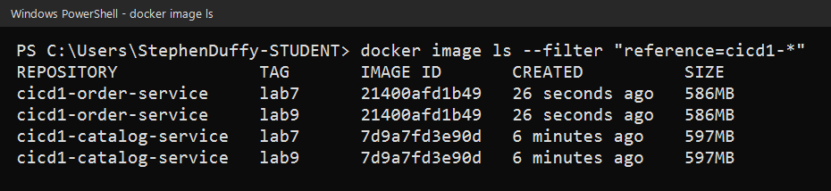

Manages purchase orders for the CICD-1 lab system. 
the port is 8082
endpoints are GET /api/orders and POST /api/orders

Lab 7

Order runs in its own docker container now on port 8082

docker build -t cicd1-order-service:lab7 .
docker run -d --name order-lab7 -p 8082:8082 cicd1-order-service:lab7

Swagger is at http://localhost:8082/swagger-ui/index.html

Why must Maven package run before docker build?
The Dockerfile doesnt build the code, it just copies the jar from the target folder. So if package didnt run there is no jar to copy and the build fails

What is the difference between an image and a running container?
The image is like the package with java and the app jar in it. The container is the image actually running. you can make more than one container from the same image

What does 8082:8082 mean? Does EXPOSE 8082 alone make the app accessible from Windows?
The first 8082 is the port on windows and the second one is the port in the container so windows 8082 goes to container 8082. EXPOSE on its own doesnt make it accessible, it just shows what port the app uses. you need the -p for that

Why might a Feign request to localhost:8081 fail when Order is in its own container?
localhost inside the order container means the order container itself and not catalog. Catalog isnt running in there so nothing is on 8081 and the request fails

Why did the Catalog Product survive after docker compose down and up -d? What would happen with an in-memory H2 database?
The h2 database file gets saved in /app/data which is the named volume. compose down removes the container but it keeps the volume so when up -d makes a new container it uses the same database file. If it was in-memory h2 the data would be gone as soon as the container stopped

Catalog Product I got back after docker compose down and docker compose up -d: id 1 "Docker Volume Test Lamp"
